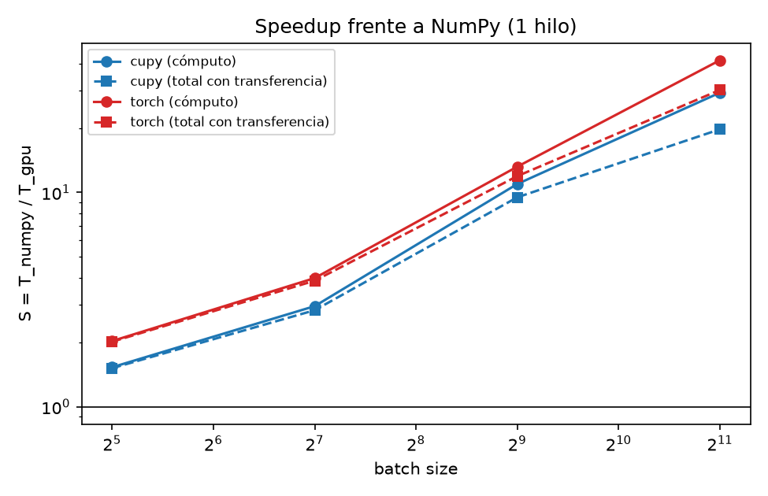
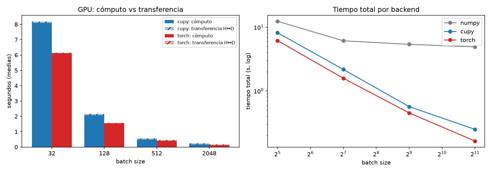
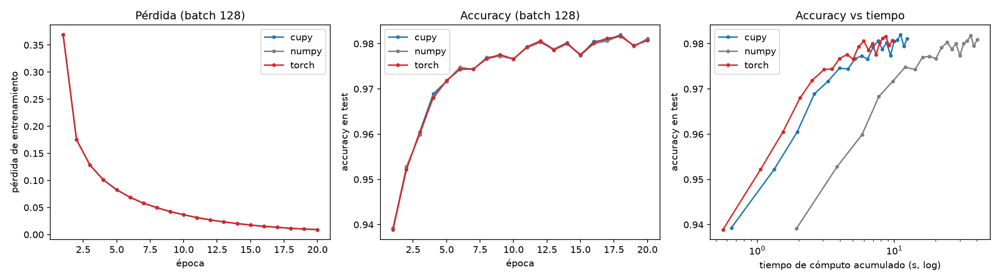
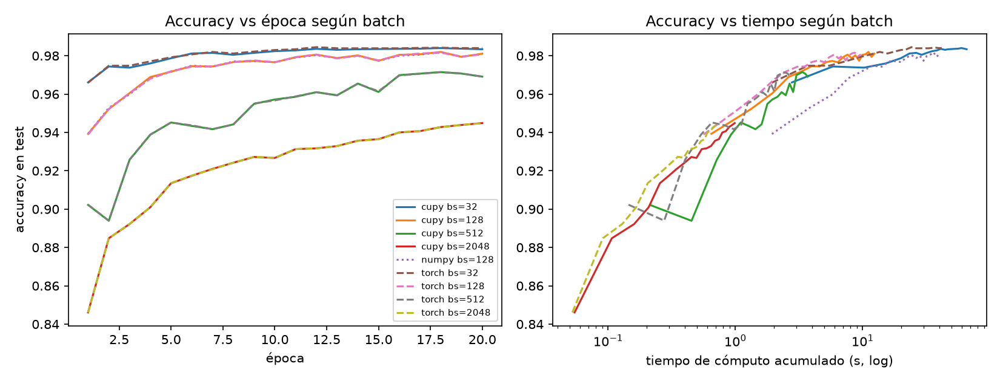

# Análisis comparativo de cómputo paralelo en el entrenamiento de un MLP sobre MNIST

**Plataformas y Algoritmos en Paralelo** · Ibero León · Otoño 2026\
**Equipo:** Francisco Marín · Luis Pablo · Rodrigo Rosales\
**Repositorio:** https://github.com/FMarin2401/ProyectoFinal_MLP\
**Fecha:** 30 de noviembre de 2026

## Resumen

Entrenamos la misma red (784 → 512 → 256 → 10) sobre MNIST con tres implementaciones: NumPy en CPU con un hilo, CuPy en GPU con retropropagación escrita a mano y PyTorch en GPU, todas con los mismos pesos iniciales y los mismos lotes. Con batch 2048, la GPU es hasta 29.2× (CuPy) y 41.4× (PyTorch) más rápida que NumPy en cómputo, pero con batch 32 la ventaja baja a 1.5–2.0×. Las tres versiones convergen a ≈ 98.1 % de accuracy en 20 épocas con batch 128, con diferencias ≤ 0.04 pp. La GPU solo conviene cuando cada kernel recibe suficiente trabajo: con batch pequeño domina el overhead de lanzamiento y, con batch grande, la transferencia por PCIe llega a un tercio del tiempo total.

## 1. Introducción

Entrenar una red densa es, en esencia, una cadena de multiplicaciones de matrices (GEMM). Cada elemento del resultado se calcula de forma independiente, lo que hace de las GEMM el caso ideal para una GPU. Aun así, que el problema sea paralelizable no garantiza que la GPU acelere: hay que copiar los datos por PCIe, cada operación tiene el costo fijo de lanzar un kernel y, si las matrices son pequeñas, no hay suficiente trabajo para ocupar a todos los multiprocesadores.

El objetivo es **medir y explicar** cuánto acelera la GPU, cuándo no lo hace y cuánto cuesta mover los datos. Para ello comparamos tres niveles de abstracción: CPU secuencial (NumPy, 1 hilo), GPU explícita (CuPy, donde nosotros controlamos la memoria y la sincronización) y un framework optimizado (PyTorch). La sección 2 describe el método, la 3 los resultados, la 4 el análisis con cálculos y la 5 las conclusiones.

## 2. Método

### 2.1 Red, datos y entrenamiento

MNIST (`mnist_784` con `fetch_openml`), píxeles en [0, 1], split estratificado 60,000 / 10,000 con semilla 42. Red 784 → 512 (ReLU) → 256 (ReLU) → 10 (softmax + entropía cruzada), con pesos He de semilla fija, generados una vez y copiados a las tres versiones. SGD sin momentum, η = 0.1, float32 y el mismo orden de lotes en las tres versiones.

### 2.2 Retropropagación

Con la convención de la plantilla, `Z = X·W + b` y cada `W` de forma (entrada, salida). El forward devuelve la pérdida promediada sobre el batch B. El backward se reduce a tres reglas aplicadas de la salida hacia la entrada:

1. **Salida (softmax + entropía cruzada):** `dZ3 = (P − Y) / B`, con P = softmax(Z3) e Y el one-hot de las etiquetas. Para una muestra, ∂(−log p_y)/∂z_c = p_c − 1[c = y]; el promedio sobre el batch aporta el 1/B.
2. **Capa lineal:** `dW = A_prevᵀ · dZ`, `db = Σ_batch dZ`, `dA_prev = dZ · Wᵀ`. Cada gradiente tiene la forma de su variable; por ejemplo, en la capa 3, dW3 = (256, B)·(B, 10) = (256, 10).
3. **ReLU:** `dZ = dA ⊙ 1[Z > 0]`: una neurona apagada no deja pasar gradiente.

Después, SGD aplica `W ← W − η·dW` *in-place*. El `/B` va **solo en dZ3**, porque las capas anteriores ya lo heredan por la regla de la cadena. Además, **no se calcula dX**, porque la entrada no tiene parámetros, lo que ahorra la GEMM más cara del backward.

### 2.3 Las tres implementaciones

| Versión | Backend | Qué escribimos | Detalles clave |
|---|---|---|---|
| V1 | NumPy, CPU, **1 hilo** | Backward y SGD a mano | `OMP/OPENBLAS/MKL_NUM_THREADS = 1` antes de importar NumPy; `threadpoolctl` confirma `num_threads: 1` (`results/env.json`) |
| V2 | CuPy, GPU | Backward y SGD a mano | Datos y pesos en VRAM todo el entrenamiento (solo sube la permutación por época); sin `.get()` ni `.item()` por iteración; pérdida acumulada en GPU |
| V3 | PyTorch, GPU | `loss.backward()` + `optimizer.step()` | Pesos copiados como `W.T`; SGD sin momentum; fp32 **sin TF32** |

En PyTorch hay tres detalles para que la comparación sea válida. Primero, `nn.Linear` guarda los pesos como (salida, entrada) y calcula `X·Wᵀ`, así que los pesos de la plantilla se copian transpuestos; si no, sería otra red. Segundo, se desactiva TF32 (`allow_tf32 = False`), porque en GPUs Ampere y posteriores PyTorch puede hacer las GEMM con mantisa de 10 bits: más rápido, pero no sería la misma aritmética fp32 que NumPy y CuPy. Tercero, la plantilla llama a `zero_grad()` antes de `loss.backward()` porque PyTorch **acumula** los gradientes en `.grad`.

### 2.4 Verificación de correctitud

**Gradient check** (diferencias finitas centradas en float64, red 20 → 8 → 6 → 4, batch 7, ε = 1e-5). Los 6 parámetros pasan con dos órdenes de magnitud de margen respecto a la tolerancia de 1e-6:

| Parámetro | W1 | b1 | W2 | b2 | W3 | b3 |
|---|---|---|---|---|---|---|
| Error relativo máx. | 4.17e-08 | 7.48e-10 | 1.27e-08 | 6.21e-10 | 1.33e-08 | 3.46e-10 |

**Consistencia** (`--consistency`, 3 pasos con los mismos lotes): máx. |W_numpy − W_cupy| = máx. |W_numpy − W_torch| = **1.5e-08**, frente a una tolerancia de 1e-4. Esto también confirma la transposición de los pesos en PyTorch.

### 2.5 Protocolo de medición

- **Protocolo T:** 3 épocas; batch 32, 128, 512 y 2048; 3 repeticiones en GPU y 2 en NumPy (media ± desviación).
- **Protocolo C:** 20 épocas con batch 128 en los tres backends y, en GPU, también con los 4 batches.
- **Cronometraje:** cada corrida es un proceso limpio, con 5 iteraciones de warm-up fuera de la medición y `synchronize` antes de leer el reloj. Esto es indispensable porque los kernels se lanzan de forma asíncrona: sin sincronizar, solo se mediría cuánto tarda la CPU en encolarlos. H→D, D→H y cómputo se miden por separado, y la evaluación en test queda fuera del cronómetro.

**Esquema de épocas.** Los FLOPs por época son constantes (≈ 144.4 GFLOP) sin importar el batch, así que el Protocolo T usa 3 épocas para medir **velocidad**. La **precisión** se mide en el Protocolo C. Con η fijo, un batch grande hace menos actualizaciones por época (1,875 / 469 / 118 / 30 para B = 32 / 128 / 512 / 2048), por eso su accuracy en el Protocolo T es menor (de 97.4 % a 89.2 %): es un hallazgo, no un error.

**FLOPs por iteración (derivados a mano).** Un producto (B × m)·(m × n) cuesta 2·B·m·n FLOPs; solo contamos GEMM:

| GEMM | Capa 1 (784×512) | Capa 2 (512×256) | Capa 3 (256×10) | Por muestra |
|---|---|---|---|---|
| Forward `A·W` | 2 · 401,408 | 2 · 131,072 | 2 · 2,560 | 1,070,080 |
| `dW = Aᵀ·dZ` | 2 · 401,408 | 2 · 131,072 | 2 · 2,560 | 1,070,080 |
| `dA = dZ·Wᵀ` | — (sin dX) | 2 · 131,072 | 2 · 2,560 | 267,264 |
| **Total** | | | | **2,407,424** |

Son **B · 2,407,424 FLOPs por iteración** y 60,000 · 2,407,424 ≈ **144.4 GFLOP por época**, lo que coincide con `flops_per_sample()` del script. ReLU, softmax, `db` y SGD son de orden B·n y pesan menos del 2 %.

**Referencias de rendimiento.** Pico FP32 teórico: 2 FLOP (FMA) × 2,560 núcleos × 2.37 GHz (boost oficial) ≈ **12,100 GFLOP/s**. SGEMM de cuBLAS medida (4096³): **6,747 GFLOP/s** (56 % del pico).

### 2.6 Hardware y software

Todo se midió el 26 de noviembre de 2026 en la misma máquina y sesión, con la laptop conectada a la corriente.

| | |
|---|---|
| GPU | NVIDIA GeForce RTX 4050 Laptop · 2,560 núcleos CUDA · 6 GB GDDR6 · TGP 105 W · PCIe 4.0 x8 |
| Driver / CUDA | Driver 610.62 · CUDA runtime 12.9 (CuPy) · PyTorch con CUDA 12.6 y cuDNN 9 |
| CPU | Intel Core i5-13450HX (10 núcleos / 16 hilos); **NumPy fijado a 1 hilo** |
| RAM / equipo | 12 GB · Lenovo 83DV · Windows 11 (build 26200) |
| Software | Python 3.12.9 · NumPy 2.4.6 · CuPy 14.2.0 · PyTorch 2.14.1+cu126 · scikit-learn 1.9.1 · pandas 2.3.3 |

## 3. Resultados

### 3.1 Tiempos y speedup (Protocolo T)

**Tabla 1.** Protocolo T (3 épocas). Tiempos en segundos; S = T_numpy / T_gpu.

| Backend | Batch | Cómputo (s) | Total (s) | H→D (s) | GFLOP/s | S cómputo | S total |
|---|---|---|---|---|---|---|---|
| NumPy | 32 | 12.38 ± 2.05 | 12.38 | — | 35 | 1× | 1× |
| NumPy | 128 | 6.12 ± 0.46 | 6.12 | — | 71 | 1× | 1× |
| NumPy | 512 | 5.37 ± 0.44 | 5.37 | — | 81 | 1× | 1× |
| NumPy | 2048 | 4.90 ± 0.07 | 4.90 | — | 88 | 1× | 1× |
| CuPy | 32 | 8.10 ± 0.74 | 8.18 | 0.081 | 54 | 1.5× | 1.5× |
| CuPy | 128 | 2.08 ± 0.16 | 2.17 | 0.092 | 210 | 2.9× | 2.8× |
| CuPy | 512 | 0.49 ± 0.04 | 0.57 | 0.075 | 888 | 11.0× | 9.5× |
| CuPy | 2048 | 0.17 ± 0.03 | 0.25 | 0.080 | 2,648 | 29.2× | 19.7× |
| PyTorch | 32 | 6.11 ± 0.14 | 6.16 | 0.042 | 71 | 2.0× | 2.0× |
| PyTorch | 128 | 1.54 ± 0.03 | 1.58 | 0.042 | 282 | 4.0× | 3.9× |
| PyTorch | 512 | 0.41 ± 0.00 | 0.45 | 0.042 | 1,065 | 13.2× | 11.9× |
| PyTorch | 2048 | 0.12 ± 0.01 | 0.16 | 0.043 | **3,669** | **41.4×** | **30.1×** |

D→H (bajar los pesos finales) cuesta ≈ 1–2 ms en todos los casos.

Como muestra la **Figura 1**, el speedup crece con el batch: con B = 32 la GPU apenas supera a un núcleo de CPU, y con B = 2048 es 29–41× más rápida en cómputo. La brecha entre el speedup de cómputo (línea continua) y el total (punteada) se abre con el batch. La **Figura 2** explica por qué: la transferencia H↔D es casi constante mientras el cómputo cae.

*Figura 1. Speedup de CuPy y PyTorch frente a NumPy de 1 hilo, en cómputo y total, según el batch (escala log).*

*Figura 2. Izquierda: tiempo de cómputo y de transferencia H↔D en GPU (s). Derecha: tiempo total por backend según el batch (s, escala log).*

### 3.2 Rendimiento en GFLOP/s

Los GFLOP/s se calculan como (3 × 144.4 GFLOP) ÷ tiempo de cómputo. En la **Figura 3**, el mejor caso (PyTorch, B = 2048) alcanza 3,669 GFLOP/s: el **54 %** de la SGEMM medida y el **30 %** del pico teórico. CuPy con B = 32 se queda en 54 GFLOP/s (0.4 % del pico), y NumPy va de 35 a 88 GFLOP/s.

*Figura 3. GFLOP/s alcanzados por backend según el batch, frente a la SGEMM medida y al pico teórico de la GPU (escala log).*

### 3.3 Convergencia (Protocolo C)

**Tabla 2.** Protocolo C (20 épocas). Tiempos de cómputo acumulado en segundos.

| Backend | Batch | Época con 95 % | Cómputo hasta 95 % (s) | Accuracy final | Cómputo 20 épocas (s) |
|---|---|---|---|---|---|
| NumPy | 128 | 2 | 3.82 | 98.09 % | 40.2 |
| CuPy | 32 / 128 / 512 / 2048 | 1 / 2 / 9 / — | 2.78 / 1.33 / 1.78 / — | 98.34 / 98.11 / 96.91 / 94.49 % | 65.6 / 12.4 / 3.7 / 1.0 |
| PyTorch | 32 / 128 / 512 / 2048 | 1 / 2 / 9 / — | 1.93 / **1.06** / 1.25 / — | 98.40 / 98.07 / 96.91 / 94.48 % | 41.8 / 9.7 / 2.7 / 0.7 |

En la **Figura 4**, con batch 128, las curvas de los tres backends se enciman y la accuracy final difiere ≤ 0.04 pp (98.09 / 98.11 / 98.07 %), muy por debajo del límite de 0.5 pp. El panel derecho muestra que la GPU llega a 95 % en 1.06 s (PyTorch), contra 3.82 s de NumPy.

*Figura 4. Batch 128, 20 épocas: pérdida de entrenamiento, accuracy en test por época y accuracy frente al tiempo de cómputo acumulado (s, escala log).*

La **Figura 5** compara los 4 batches en GPU. Con B = 2048 la red **no llega a 95 % en 20 épocas** (94.5 %). No es un error: CuPy y PyTorch dan la misma curva, y la accuracy sigue subiendo en la última época. Con η = 0.1 fijo, B = 2048 hace 30 pasos por época (600 en total) contra 469 (9,380 en total) de B = 128: **15.6× menos actualizaciones**. Cada paso usa un gradiente más preciso, pero avanza lo mismo, así que la red no ha terminado de entrenar. Aun así supera el 90 % exigido; con más épocas o con η escalado al batch alcanzaría la misma accuracy.

*Figura 5. GPU con los 4 batches: accuracy en test por época y frente al tiempo de cómputo acumulado (s, escala log).*

## 4. Análisis

### 4.1 Subutilización con batch pequeño

**Tabla 3.** Tiempo de cómputo por iteración (ms) = cómputo ÷ iteraciones (5,625 con B = 32; 90 con B = 2048).

| Batch | NumPy | CuPy | PyTorch |
|---|---|---|---|
| 32 | 2.2 | 1.44 | 1.09 |
| 128 | 4.3 | 1.48 | 1.09 |
| 512 | 15.2 | 1.39 | 1.15 |
| 2048 | 54.5 | 1.86 | 1.31 |

En GPU, el tiempo por iteración es **casi constante** (1.1–1.9 ms) aunque el trabajo crece **64×**: lo pone un costo fijo (lanzar cada kernel desde Python, latencia del driver, overhead de CuPy o PyTorch), no la aritmética. Con B = 32, una iteración hace 32 × 2,407,424 ≈ 77 MFLOP, que a la velocidad de la SGEMM con esas formas (1,531 GFLOP/s) tomaría ≈ 0.05 ms; CuPy tarda 1.44 ms, así que **≈ 96 % del tiempo es overhead**. Además, una GEMM de (32 × 784)·(784 × 512) no genera bloques suficientes para ocupar todos los multiprocesadores, por eso se llega solo al 0.4 % del pico. En NumPy, en cambio, el tiempo crece con el batch (2.2 → 54.5 ms) porque la CPU sí está limitada por el cómputo; de ahí que el speedup suba con el batch.

### 4.2 Saturación con batch grande

Los GFLOP/s de la GPU suben casi linealmente (CuPy: 54 → 210 → 888 → 2,648) y **no se aplanan en B = 2048** (Figura 3): la red no satura la GPU. Con B = 2048, una iteración hace ≈ 4.93 GFLOP, que a la SGEMM con esas formas (6,880 GFLOP/s) tomaría 0.72 ms; CuPy tarda 1.86 ms (39 % en aritmética útil) y PyTorch 1.31 ms (55 %). La SGEMM con nuestras formas también crece con el batch (1,531 → 2,923 → 5,237 → 6,880 GFLOP/s): con pocas filas no hay suficiente paralelismo. NumPy se satura pronto (71 → 88 GFLOP/s de B = 128 a 2048), porque un núcleo ya está casi al límite de su capacidad vectorial.

### 4.3 Costo de la transferencia por PCIe

Se suben una vez X de entrenamiento (60,000 × 784 × 4 B = 188 MB), X de prueba (31 MB) y etiquetas: ≈ **220 MB**. Bytes ÷ tiempo: 220 MB ÷ 0.080 s ≈ **2.7 GB/s** (CuPy) y 220 MB ÷ 0.042 s ≈ **5.2 GB/s** (PyTorch), frente a ≈ 15.75 GB/s teóricos de PCIe 4.0 x8 (17–33 %). La causa es que se copia desde memoria *pageable*: el driver primero pasa los datos a un búfer fijado (*pinned*) antes del DMA.

Como la transferencia es fija y el cómputo baja con el batch, su peso crece: en CuPy es el 1 % del total con B = 32 (0.081 de 8.18 s) y el **32 %** con B = 2048 (0.080 de 0.25 s). Por eso el speedup total de CuPy con B = 2048 (19.7×) queda tan por debajo del de cómputo (29.2×). Al mantener los datos y pesos en VRAM, esta transferencia se paga **una sola vez** y no en cada lote.

### 4.4 cuBLAS, cuDNN y fusión de kernels

CuPy y PyTorch usan las mismas GEMM de cuBLAS, pero PyTorch es 1.33×, 1.35×, 1.20× y 1.42× más rápido en cómputo (B = 32, 128, 512, 2048). La diferencia está en todo lo demás. En CuPy, cada operación elemental del backward (`P.copy()`, restar el one-hot, `/B`, la máscara `Z > 0`, las sumas de `db`, cada `-=` del SGD) es un kernel aparte que lee y escribe toda la matriz y se lanza desde Python. PyTorch usa kernels fusionados o especializados: `CrossEntropyLoss` combina log-softmax y NLL, `nn.Linear` suma el bias dentro de la GEMM, el SGD usa kernels *foreach* que actualizan varios tensores a la vez, y el autograd corre en C++. Menos kernels y menos overhead se reflejan en su menor ms/iter en todos los batches (Tabla 3). **cuDNN no participa**: acelera convoluciones, normalización y RNNs, y nuestra red solo tiene capas densas.

### 4.5 Batch y convergencia

El batch más rápido por época no es el que entrena más rápido (Figura 5). B = 2048 hace una época en 0.04–0.05 s, pero no llega a 95 %. B = 32 llega a 95 % en la primera época, pero cada época es lenta (2.78 s hasta 95 % en CuPy). **B = 128 es el mejor equilibrio**: 95 % en 1.06 s (PyTorch) o 1.33 s (CuPy), contra 3.82 s de NumPy.

### 4.6 Variabilidad y limitaciones

PyTorch es muy estable (desviación ≤ 5 % de la media); NumPy con B = 32 (± 17 %) y CuPy con B = 2048 (± 20 %, en apenas 0.17 s) varían más. Limitaciones: (1) **GPU de laptop**, cuyo reloj depende de temperatura y potencia, por lo que también comparamos contra la SGEMM medida; (2) **Windows (WDDM)**, que agrupa lanzamientos de kernels y añade latencia, una hipótesis compatible con el ms/iter constante que no medimos aparte; (3) **memoria pageable**, que limita el ancho de banda H→D; (4) **línea base de un núcleo** de 16 hilos disponibles, como pide el enunciado; (5) **pocas repeticiones** (3 en GPU, 2 en NumPy, 1 en el Protocolo C), y (6) **6 GB de VRAM**, suficientes para MNIST (≈ 220 MB) pero no para datasets mucho mayores.

## 5. Conclusiones

1. **Las tres implementaciones son equivalentes:** gradcheck con error máximo de 4.2e-08, consistencia de 1.5e-08 y ≈ 98.1 % de accuracy con diferencias ≤ 0.04 pp.
2. **La GPU acelera solo con batch grande:** 29.2× (CuPy) y 41.4× (PyTorch) en cómputo con B = 2048, pero 1.5–2.0× con B = 32, donde ≈ 96 % del tiempo por iteración es overhead.
3. **PCIe deja de ser despreciable con batch grande:** pasa de 1 % a 32 % del tiempo total en CuPy y reduce su speedup de 29.2× a 19.7×.
4. **El framework optimizado gana al código manual:** con las mismas GEMM de cuBLAS, PyTorch es 1.2–1.4× más rápido que CuPy por la fusión de kernels y el autograd en C++, y alcanza el 54 % de la SGEMM medida.
5. **El batch más rápido por época no es el que entrena más rápido:** B = 128 llega a 95 % en ≈ 1.1 s, mientras que B = 2048 no llega en 20 épocas por hacer 15.6× menos actualizaciones.

## Referencias

1. Kirk, D. B. y Hwu, W.-m. W. *Programming Massively Parallel Processors: A Hands-on Approach*. Morgan Kaufmann.
2. LeCun, Y., Bottou, L., Bengio, Y. y Haffner, P. (1998). Gradient-based learning applied to document recognition. *Proceedings of the IEEE*, 86(11), 2278–2324.
3. He, K., Zhang, X., Ren, S. y Sun, J. (2015). Delving deep into rectifiers. *ICCV*.
4. Rumelhart, D., Hinton, G. y Williams, R. (1986). Learning representations by back-propagating errors. *Nature*, 323, 533–536.
5. CuPy: https://docs.cupy.dev · PyTorch: https://pytorch.org/docs/stable/index.html
6. NVIDIA cuBLAS: https://docs.nvidia.com/cuda/cublas/ · cuDNN: https://docs.nvidia.com/deeplearning/cudnn/
7. scikit-learn, `fetch_openml`: https://scikit-learn.org/stable/modules/generated/sklearn.datasets.fetch_openml.html
8. Plantilla `proyecto_mlp_mnist.py` y `run_experiments.py`: material del profesor del curso (Ibero León, 2026); solo se completaron las funciones `# TODO (estudiante)`.

## Declaración de uso de IA

Se usó **Claude** (Anthropic) como asistente durante el proyecto:

- **Francisco:** con Claude Code generó el código de `backward_cupy`, `sgd_update_cupy` y `torch_backward_and_update` a partir de la derivación del backward del equipo; escribió `setup_entorno.ps1`; diagnosticó problemas del entorno (pandas 3 con `fetch_openml`, descarga interrumpida de PyTorch); ejecutó los experimentos y redactó `docs/resultados.md` y el esqueleto de este reporte.
- **Luis Pablo:** con Claude Code generó el código de `backward_numpy` y `sgd_update_numpy` a partir de la derivación del backward del equipo (el commit correspondiente aparece con autoría de Claude en el historial del repositorio). Él ejecutó y validó el gradient check, derivó los FLOPs por iteración y documentó la versión NumPy en `docs/numpy.md`.
- **Rodrigo:** con Claude (claude.ai) redactó este reporte a partir del esqueleto, de `docs/resultados.md`, `docs/numpy.md`, `docs/derivacion_backward.md` y de los CSV del script, y lo revisó contra los datos de `results/`. También lo usó para estructurar la presentación y su guion.

Todo el código generado se verificó con el gradient check, la prueba de consistencia y los entrenamientos de prueba. Cada integrante puede derivar y explicar el backward y la sincronización.
