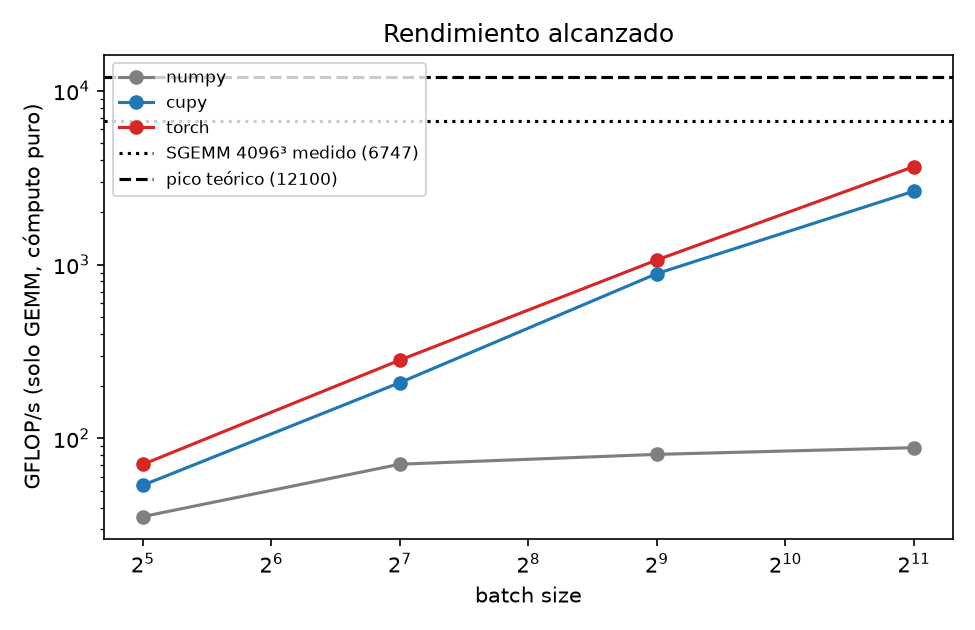

<!--
  ESQUELETO DEL REPORTE (para Rodrigo)
  - Todo lo marcado con ✍️ es para redactar. Borra las notas ✍️ al terminar.
  - Los números y el análisis ya están en docs/resultados.md: cópialos de ahí, no los recalcules.
  - Extensión: 6–10 páginas en PDF (fuera de ese rango cae a "Insuficiente" en el criterio 7).
  - Cada figura tiene que citarse en el texto ("como muestra la Figura 2...").
  - Al final: exportar a PDF (ver la sección "Cómo exportar a PDF" al final del archivo).
-->

# Análisis comparativo de cómputo paralelo en el entrenamiento de un MLP sobre MNIST

**Plataformas y Algoritmos en Paralelo** · Ibero León · Otoño 2026
**Equipo:** Francisco Marín · Luis Pablo · Rodrigo Rosales
**Repositorio:** https://github.com/FMarin2401/ProyectoFinal_MLP
**Fecha:** ✍️ (día de entrega)

## Resumen

✍️ 4–6 líneas: qué se hizo (la misma red en NumPy de 1 hilo, CuPy y PyTorch), el resultado principal (hasta 29× en CuPy y 41× en PyTorch en cómputo con batch 2048, pero solo 1.5–2× con batch 32), la convergencia (≈ 98.1 % en las 3 versiones) y la conclusión principal (la GPU solo conviene si se le da suficiente trabajo por kernel; con batch chico domina el overhead).

## 1. Introducción

✍️ ½ página. Ideas:
- Entrenar una red es, en esencia, una cadena de multiplicaciones de matrices (GEMM), lo que la hace ideal para GPU.
- Objetivo: medir y explicar cuánto acelera la GPU, cuándo no acelera y cuánto cuesta mover datos CPU ↔ GPU.
- Tres niveles de abstracción: CPU secuencial (NumPy), GPU explícita (CuPy) y framework optimizado (PyTorch).
- Estructura del reporte.

## 2. Método

### 2.1 Red, datos y entrenamiento

✍️ Especificaciones (están en el enunciado, sección 3):
- MNIST (`mnist_784` con `fetch_openml`), valores en [0, 1], split estratificado 60,000 / 10,000, semilla 42.
- Red 784 → 512 (ReLU) → 256 (ReLU) → 10 (softmax + entropía cruzada). Pesos He con semilla fija, generados una vez y copiados a las 3 versiones.
- SGD sin momentum, η = 0.1, float32, mismo orden de lotes en las 3 versiones.

### 2.2 Retropropagación

✍️ Resumir [`derivacion_backward.md`](derivacion_backward.md) (½–1 página). Lo esencial:
- `dZ3 = (softmax(Z3) − one_hot(y)) / B`
- Para cada capa: `dW = A_prevᵀ · dZ`, `db = Σ_batch dZ`, `dA_prev = dZ · Wᵀ`
- ReLU: `dZ = dA ⊙ (Z > 0)`
- SGD: `W ← W − η · dW`
- Por qué el `/B` va solo en `dZ3` y por qué no se calcula `dX`.

### 2.3 Las tres implementaciones

✍️ Una tabla y un párrafo por versión:

| Versión | Backend | Qué escribimos nosotros | Detalles clave |
|---|---|---|---|
| V1 | NumPy, CPU, **1 hilo** | Backward y SGD a mano | `OMP/OPENBLAS/MKL_NUM_THREADS = 1` antes de importar NumPy; evidencia en `results/env.json` |
| V2 | CuPy, GPU | Backward y SGD a mano | Datos y pesos en VRAM todo el entrenamiento; sin `.get()` ni `.item()` por iteración; la pérdida se acumula en la GPU |
| V3 | PyTorch, GPU | `loss.backward()` + `optimizer.step()` | Pesos copiados como `W.T` (`nn.Linear` guarda (salida, entrada)); SGD sin momentum; fp32 **sin TF32** |

### 2.4 Verificación de correctitud

✍️ Dos pruebas (números en [`numpy.md`](numpy.md) y en [`resultados.md`](resultados.md)):
- **Gradient check** (diferencias finitas, float64, red pequeña): error relativo máx. 4.2e-08 en los 6 parámetros (tolerancia 1e-6). Poner la tabla de `numpy.md`.
- **Consistencia** (`--consistency`, 3 pasos con los mismos lotes): máx. |W_numpy − W_cupy| = máx. |W_numpy − W_torch| = 1.5e-08 (tolerancia 1e-4).

### 2.5 Protocolo de medición

✍️ Explicar:
- **Protocolo T:** 3 épocas; batch 32, 128, 512 y 2048; 3 repeticiones en GPU y 2 en NumPy; media ± desviación.
- **Protocolo C:** 20 épocas; batch 128 en los 3 backends, y en GPU también con los 4 batches.
- Cada corrida en un proceso limpio, con warm-up antes de medir y `synchronize` antes de leer el reloj. H→D, D→H y cómputo se miden por separado; la evaluación en test queda fuera del cronómetro.
- **Esquema de épocas:** copiar la justificación de [`resultados.md`](resultados.md#esquema-de-épocas-justificación-pedida-por-la-rúbrica).
- **FLOPs por iteración derivados a mano:** la tabla de [`numpy.md`](numpy.md#flops-por-iteración) → `B · 2,407,424`, ≈ 144.4 GFLOP por época (coincide con `flops_per_sample()` del script).
- **Pico FP32 y SGEMM de referencia:** ver [`resultados.md`](resultados.md#hardware-y-software).

### 2.6 Hardware y software

✍️ Copiar la tabla de [`resultados.md`](resultados.md#hardware-y-software) (la rúbrica exige hardware y versiones **completos**).

## 3. Resultados

### 3.1 Tiempos y speedup (Protocolo T)

✍️ La tabla del Protocolo T de `resultados.md` (si no cabe, quitar las columnas de % de SGEMM y % del pico y dejarlas para 4.2) + 2–3 frases que citen las figuras.

### 3.2 Rendimiento en GFLOP/s

✍️ 2–3 frases: el mejor caso (PyTorch, B = 2048) llega a 3,669 GFLOP/s = 54 % de la SGEMM y 30 % del pico; NumPy de 35 a 88 GFLOP/s.

### 3.3 Convergencia (Protocolo C)

✍️ La tabla del Protocolo C de `resultados.md` + frases: las 3 versiones terminan en ≈ 98.1 % y difieren ≤ 0.04 pp; tiempo hasta 95 %; **batch 2048 no llega a 95 % y hay que explicar por qué** (si no se explica, la rúbrica penaliza).

## 4. Análisis

✍️ La parte que más pesa (criterio 5, 15 pts). La rúbrica pide **datos y cálculos en cada afirmación**, no solo explicaciones cualitativas. Todo está en [`resultados.md`](resultados.md#puntos-para-el-análisis-con-cálculos); redactarlo con nuestras palabras:

### 4.1 Subutilización con batch pequeño
✍️ Tabla de ms por iteración: en GPU es ≈ constante (1.1–1.9 ms) aunque el trabajo crece 64× → domina el overhead de lanzar kernels y de Python, no la aritmética. Con B = 32 la GPU llega al 0.4 % del pico.

### 4.2 Saturación con batch grande
✍️ Los GFLOP/s siguen creciendo hasta B = 2048, sin aplanarse; la SGEMM con nuestras formas también crece con el batch. NumPy se satura en ≈ 88 GFLOP/s.

### 4.3 Costo de PCIe
✍️ **Bytes ÷ ancho de banda** (lo pide la rúbrica): ≈ 220 MB ÷ 0.08 s ≈ 2.7 GB/s (CuPy) y ÷ 0.042 s ≈ 5.2 GB/s (PyTorch), frente a ≈ 15.75 GB/s de PCIe 4.0 x8. Pesa 1 % del total con B = 32 y 32 % con B = 2048, por eso el speedup total (19.7×) queda muy por debajo del de cómputo (29.2×). Los datos se suben una sola vez gracias a que se quedan en VRAM.

### 4.4 cuBLAS, cuDNN y fusión de kernels: por qué PyTorch supera a CuPy
✍️ PyTorch es 1.2–1.4× más rápido en cómputo con las mismas GEMM de cuBLAS: menos kernels por iteración (`CrossEntropyLoss` combina log-softmax y NLL, el bias va dentro de la GEMM, el SGD es *foreach*) y autograd en C++. En CuPy, cada operación elemental es un kernel aparte, lanzado desde Python. cuDNN no participa porque no hay convoluciones.

### 4.5 Batch y convergencia
✍️ El batch más rápido por época no es el que converge antes: B = 128 es el mejor equilibrio (95 % en ≈ 1.1–1.3 s).

### 4.6 Limitaciones
✍️ Ver la sección 7 de `resultados.md`: GPU de laptop (reloj y temperatura), Windows/WDDM, memoria no fijada, pocas repeticiones, baseline de un solo núcleo.

## 5. Conclusiones

✍️ 3–5 conclusiones, **cada una con su número**. Por ejemplo:
1. Las tres implementaciones son equivalentes (gradcheck 4.2e-08; consistencia 1.5e-08; accuracy ≈ 98.1 %).
2. La GPU acelera hasta 29× (CuPy) y 41× (PyTorch) en cómputo, pero solo con batch grande; con B = 32, apenas 1.5–2×.
3. Con batch grande la transferencia por PCIe pasa a ser un tercio del tiempo total.
4. Un framework optimizado (PyTorch) le gana a CuPy escrito a mano por la fusión de kernels y el menor overhead.
5. Para entrenar, el batch óptimo en tiempo hasta 95 % es 128, no el más grande.

## Referencias

✍️ Las que usemos de la sección C.4 del enunciado, por ejemplo:
1. Kirk, D. B. y Hwu, W.-m. W. *Programming Massively Parallel Processors: A Hands-on Approach*. Morgan Kaufmann.
2. LeCun, Y., Bottou, L., Bengio, Y. y Haffner, P. (1998). Gradient-based learning applied to document recognition. *Proceedings of the IEEE*, 86(11), 2278–2324.
3. He, K., Zhang, X., Ren, S. y Sun, J. (2015). Delving deep into rectifiers. *ICCV*.
4. Rumelhart, D., Hinton, G. y Williams, R. (1986). Learning representations by back-propagating errors. *Nature*, 323, 533–536.
5. Documentación de CuPy: https://docs.cupy.dev
6. Documentación de PyTorch: https://pytorch.org/docs/stable/index.html
7. NVIDIA cuBLAS: https://docs.nvidia.com/cuda/cublas/
8. Plantilla `proyecto_mlp_mnist.py` y `run_experiments.py`: material del profesor del curso (**hay que citarla**, lo pide la sección 8 del enunciado).

## Declaración de uso de IA

✍️ **Obligatoria (−5 pts si falta).** El enunciado permite la IA "como apoyo para entender conceptos o depurar" y pide declarar **herramienta y uso**. Hay que ser honestos también con lo que generó código. Borrador; que cada quien revise y complete su parte:

> Se usó **Claude Code** (Anthropic, modelo Claude) como asistente durante el proyecto:
> - **Francisco:** generó el código de `backward_cupy`, `sgd_update_cupy` y `torch_backward_and_update` a partir de la derivación del backward del equipo. También escribió el script de instalación `setup_entorno.ps1`, ayudó a diagnosticar problemas del entorno (incompatibilidad de pandas 3 con `fetch_openml`, descarga interrumpida de PyTorch), ejecutó los experimentos y redactó el resumen de resultados (`docs/resultados.md`) y este esqueleto del reporte.
> - **Luis Pablo:** ✍️ (describir su uso; su commit de NumPy aparece con autoría de Claude).
> - **Rodrigo:** ✍️ (describir su uso en la redacción del reporte y la presentación).
>
> Todo el código generado se verificó con el gradient check, la prueba de consistencia entre backends y los entrenamientos de prueba. Cada integrante puede derivar y explicar el backward y la sincronización.

---

## Cómo exportar a PDF

Opciones (elegir una):
- **VS Code:** instalar la extensión *Markdown PDF* (yzane.markdown-pdf), abrir este archivo, `Ctrl+Shift+P` → "Markdown PDF: Export (pdf)". Las imágenes se toman de `../results/`.
- **Pandoc** (si lo instalan): `pandoc docs/reporte.md -o docs/reporte.pdf --resource-path=docs`.
- **Google Docs / Word:** pegar el texto y subir las figuras de `results/`.

Antes de exportar: borrar este bloque, el comentario del inicio y todas las notas ✍️, y revisar que queden **6–10 páginas**.
